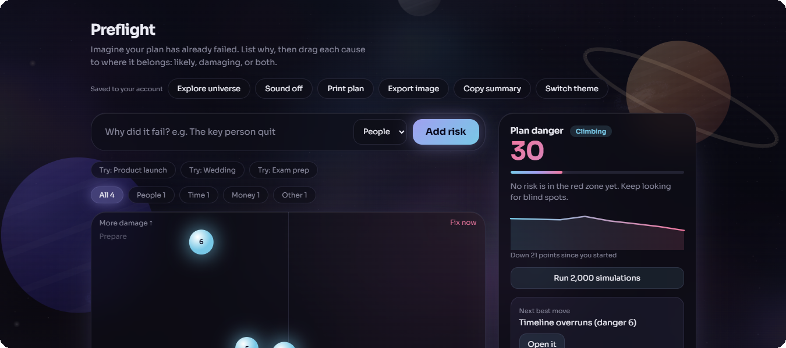
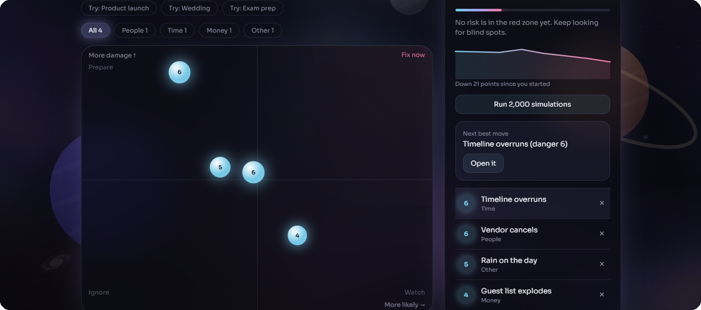
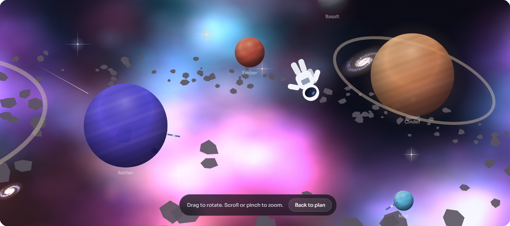

# Preflight

**Find out how your plan fails before it does.**

Preflight is a pre-mortem tool. You imagine your plan has already failed, list every reason why, and drag each cause onto a map of how likely it is against how damaging it would be. It then runs 2,000 simulations of your plan and tells you the odds it survives.

The project has two separate parts: a static **client** (one HTML file) and a small **server** that stores plans in a database (MongoDB or SQLite). Behind the app sits a draggable 3D universe you can open and explore.



## Features

**Planning**
- **Risk map:** drag glowing orbs across a likelihood and damage grid. Score, size and colour update live.
- **Plan danger score:** one number from 0 to 100 with a gradient meter and a flight rank, from "Cleared for takeoff" to "Mayday".
- **Survival simulation:** runs 2,000 trials and shows the chance your plan survives, with a histogram of calm and disaster runs.
- **Next best move:** points at the highest-danger risk you have not handled yet.
- **Handled risks:** mark a risk as handled and its danger drops by 70%.
- **Prevention notes and due dates:** write the first step to prevent each risk and set a date. Overdue steps turn pink.
- **Categories and filters:** People, Time, Money, Tech and Other.
- **Ready-made scenarios:** product launch, wedding and exam prep.
- **Danger over time:** a small graph of your plan danger score each time it changes.

**Sharing and saving**
- **Database:** every change is saved through the API. "Copy plan link" gives a link that opens the same plan on any device.
- **Export image, print plan, copy summary, undo.**



## Explore universe

Click **Explore universe** and the app fades away, leaving a 3D space scene you can move around: glowing nebula clouds, spiral galaxies, sparkling stars, ten lit planets, an asteroid belt, a shattered world, satellites and a tumbling astronaut. Drag to rotate, scroll or pinch to zoom, and press `Esc` to return.



## Project structure

```
preflight/
  client/              static front end, no build step
    index.html         the whole app
    config.js          set the API address here
  server/              database API
    api/plan.js        API as a Vercel serverless function (MongoDB)
    local.js           local server (MongoDB, SQLite or JSON file) that also serves the client
    package.json
    vercel.json
    .env.example       copy to .env and add your MongoDB URL
  docs/screenshots/    images used in this README
  README.md
  LICENSE
```

## Run it locally

You need [Node.js](https://nodejs.org) 22.5 or newer for the built-in SQLite database.

```bash
cd server
npm start
```

Open `http://localhost:3000`. The local server serves both the client and the API, so `config.js` can stay empty. The database file is created at `server/data/preflight.db`.

### Use MongoDB locally

```bash
cd server
cp .env.example .env     # then edit .env and set MONGODB_URI
npm install
npm start
```

The console should say `database: MongoDB`. Never commit `.env` and never put the URL in `client/`, because everything in the client is visible to anyone who opens the page.

## Deploy to Vercel (client and server as two projects)

Import the same GitHub repository twice, once per part. Leave the framework as **Other** and the build settings empty.

**1. Server project**
1. Set **Root Directory** to `server`.
2. Add environment variables:

| Name | Value | Required |
| --- | --- | --- |
| `MONGODB_URI` | your MongoDB connection string | yes |
| `MONGODB_DB` | database name, for example `preflight` | no, defaults to `preflight` |
| `CLIENT_ORIGIN` | your client URL, for example `https://preflight.vercel.app` | no, defaults to any site |

3. Deploy and copy the URL, for example `https://preflight-api.vercel.app`.
4. In MongoDB Atlas, open Network Access and allow `0.0.0.0/0`. Vercel does not use fixed IP addresses.

**2. Client project**
1. Edit `client/config.js` and set `window.PREFLIGHT_API` to the server URL from above. Commit the change.
2. Set **Root Directory** to `client`. It needs no environment variables.
3. Deploy.

Optionally go back to the server project, set `CLIENT_ORIGIN` to the client URL and redeploy, so only your site can call the API.

## How the database works

Each browser gets a random workspace id, stored in local storage and shown in the "Copy plan link" URL as `?w=<id>`. The server keeps one record per workspace.

| Method | Path | What it does |
| --- | --- | --- |
| `GET` | `/api/plan?w=<id>` | Returns the saved plan, or `{}` if there is none |
| `PUT` | `/api/plan?w=<id>` | Saves the plan (JSON, up to 1 MB) |

There are no accounts. Anyone with a workspace link can read and edit that plan, so share it only with people you trust. If the API is unreachable, the app saves to the browser's local storage instead.

## Notes

- Fonts load from Google Fonts. Without a connection the app falls back to system fonts.
- Printing and downloads can be blocked when the page is embedded. Use **Copy summary** or the image preview as a fallback.
- Motion respects the `prefers-reduced-motion` setting.

## Tech

Plain HTML, CSS and JavaScript on the client, with the universe drawn on one canvas using a small 3D projection. The server is Node with MongoDB or Node's built-in SQLite. The only npm dependency is the `mongodb` driver.

## License

MIT. See [LICENSE](LICENSE).
